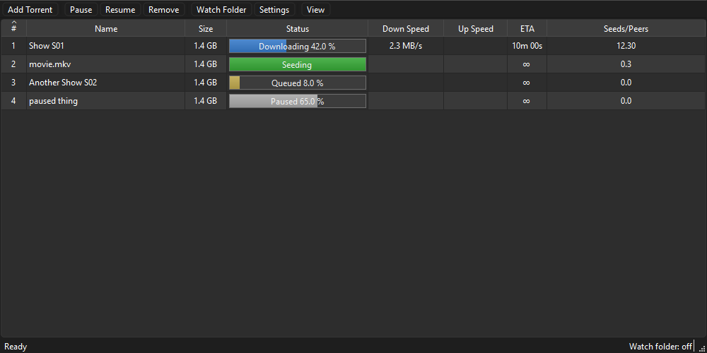
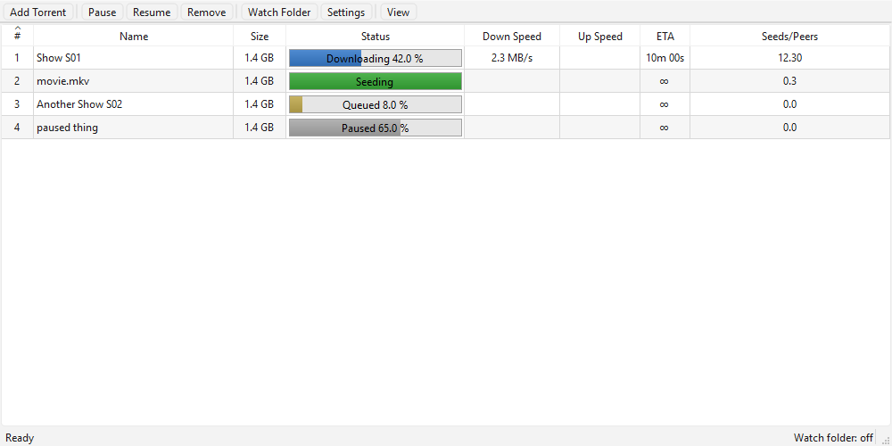

# Torrent Downloader

A small BitTorrent client for Windows that lives in the system tray. It's built on
[libtorrent](https://www.libtorrent.org/) (the engine behind qBittorrent and Deluge) and PyQt6.

It's meant to be left running in the background: drop `.torrent` files into a watch folder or
pass them on the command line, and finished downloads appear in your download folder, with only
finished files there, never half-downloaded ones.

| Dark | Light |
|---|---|
|  |  |

## Features

- **System tray app.** Closing the window hides it to the tray; **Quit** in the tray menu exits.
  Notifications when torrents are added and finished.
- **Only finished files in your download folder.** Unfinished downloads are kept in an
  `_incomplete` folder and moved into the download folder when they're done (can be turned off).
- **Never overwrites.** If a finished download's name is already taken, it's saved as
  `Name (2)` (or `(3)`, …). Torrents with the same folder name but different files are merged
  into one folder.
- **Skips what you already have.** Adding a torrent you've already downloaded (as a `.torrent`
  file or a magnet link) is skipped while its files are still in place.
- **Watch folder.** Every `.torrent` file dropped into a folder is added, then deleted.
- **Command line and single instance.** `TorrentDownloader.exe file.torrent magnet:?...` adds
  silently; if the app is already running, the torrents are handed to it.
- **Safe "remove and delete files".** Never deletes files or folders another torrent in the
  list still uses.
- **Remove when complete** (optional): finished torrents leave the list instead of seeding.
- **Detailed log** of everything that happens (adds, progress, stalls, moves, errors, crashes)
  in `cli.log`.
- **Light / dark theme** (or follow Windows) and **adjustable text size**.
- Speed limits, max active downloads, connection limits, magnet links, drag and drop, resume
  after restart.
- On first run, picks up the download folder from BitTorrent/µTorrent if they're installed.

## Requirements

- Windows 10 or 11 (64-bit)
- Python 3.10 or newer (tested with 3.13)
- Python packages from `requirements.txt`: `libtorrent` 2.0.x and `PyQt6` 6.8 or newer
- **OpenSSL 1.1 DLLs** for libtorrent (see below)
- To build the `.exe`: `pyinstaller`

### OpenSSL DLLs

The Windows `libtorrent` wheel on PyPI needs `libcrypto-1_1-x64.dll` and `libssl-1_1-x64.dll`,
and doesn't include them. Without them, starting the app fails with `ImportError: DLL load failed`.

Copy both files (64-bit, from any OpenSSL **1.1.1** build for Windows) into libtorrent's package
folder. This prints where that is:

```bash
python -c "import importlib.util; print(importlib.util.find_spec('libtorrent').submodule_search_locations[0])"
```

The app adds that folder to the DLL search path at startup, and the build copies the DLLs
next to the exe.

## Install and run from source

```bash
git clone https://github.com/jakeiiiii/torrent-downloader.git
cd torrent-downloader
python -m venv .venv
.venv\Scripts\activate
pip install -r requirements.txt
```

Copy the OpenSSL DLLs into libtorrent's folder (above), then:

```bash
python main.py
```

You can also pass torrents straight away: `python main.py file.torrent "magnet:?xt=..."`.

## Build the exe

```bash
pip install pyinstaller
pyinstaller --noconfirm build.spec
```

The result is `dist\TorrentDownloader\TorrentDownloader.exe`, together with its `_internal`
folder. Copy the whole `dist\TorrentDownloader` folder wherever you want to keep it.

It's a folder build on purpose: a one-file exe unpacks itself to a temp folder on every launch
(about 1.3 s), which is too slow for launcher tools that delete the `.torrent` file a second
after starting the app. Settings and data aren't stored next to the exe, so rebuilding or
replacing the folder doesn't lose anything (quit the app first).

To redraw the icon: `python tools/make_icon.py` (writes `resources/icons/app.ico`).

## Using it

### Adding torrents

- **Add Torrent** on the toolbar or in the tray menu: pick a `.torrent` file or paste a magnet
  link, and choose where it goes.
- **Drag and drop** `.torrent` files onto the window.
- **Command line:** see below.
- **Watch folder:** turn it on in Settings, or from the tray menu or toolbar. Each `.torrent`
  file dropped into the folder is added and then deleted. A file that can't be added (not a
  valid torrent, still being written, …) stays in the folder, and the reason is logged once.

### The list

Right-click a torrent for **Pause**, **Resume**, **Open Folder**, **Remove (keep files)** and
**Remove (delete files)**. The status column shows a progress bar and the state: Downloading,
Seeding, Queued, Paused, Checking, Downloading metadata (magnet links), Moving.

**Remove (delete files)** deletes only what that torrent downloaded. A file another torrent in
the list maps to the same path is kept, and so is a folder another torrent will download into or
one that holds files of your own. Files Windows has locked are retried for about 20 seconds.

### Where downloads go

With **Keep unfinished downloads in a separate folder** on (the default):

1. Each torrent downloads into its own folder, `<download folder>\_incomplete\<id>\`, where
   `<id>` is the first 8 characters of its info hash. Two torrents with the same names can't
   write into each other's files.
2. When it's finished, it moves into the download folder. On the same drive that's an instant
   rename, not a copy.
   - If a folder with the same name is already there, the files are merged into it.
   - If any file's name is already taken, the whole download is renamed `Name (2)` first.
3. The empty `_incomplete\<id>` folder is deleted, and so is `_incomplete` once nothing is left
   in it. It's created again when the next download starts.
4. Then the "finished" notification shows, and with **Remove from list when complete** on, the
   torrent leaves the list.

With the option off, downloads go straight into the download folder, as in most clients.
Turning it off only affects torrents added afterwards; ones already in `_incomplete` still move
out when they finish.

You can choose a different incomplete folder in Settings, for example on a faster drive. A folder
you choose yourself is never deleted.

### Torrents you already have

Every finished torrent is remembered in `completed.json`, even after it leaves the list. If the
same torrent (same info hash) is added again while all its files are still where they went, at
full size, it's skipped: the tray says **Already downloaded** and `cli.log` records
`ALREADY DOWNLOADED (skipped)`. If any of its files are gone, it downloads again and the missing
files are put back in the same folder.

A torrent that's still in the list isn't added twice either. A different torrent that happens to
have the same name is never skipped.

### Appearance

**View** on the toolbar: theme (**Same as Windows**, **Light**, **Dark**) and text size.
Keyboard: **Ctrl +** (or **Ctrl =**) larger, **Ctrl −** smaller, **Ctrl 0** default. Both are
also in **Settings → Appearance**, and both are remembered.

## Command line

```
TorrentDownloader.exe [file.torrent | "magnet:?xt=..."] ...
```

- Adds each torrent silently to the download folder.
- Only one copy runs per Windows user. If it's already running, a new launch hands its torrents
  to the running copy over a local connection and exits. With no arguments, it shows the running
  copy's window.
- `.torrent` files are read the moment the app starts, so a launcher may delete them right after.
- The exe has no console; results go to `cli.log`.

Exit codes of a launch that hands torrents to the running copy:

| Code | Meaning |
|---|---|
| 0 | Everything was added |
| 1 | At least one item couldn't be added (see `cli.log`) |
| 2 | The running copy couldn't be reached |

## Files

Everything is kept in `%APPDATA%\TorrentDownloader\`, not next to the exe:

| File | What it is |
|---|---|
| `settings.ini` | Your settings (see below) |
| `cli.log` | The log. Over 10 MB it's renamed `cli.log.1` (one old copy is kept) and a new one starts. |
| `completed.json` | Finished torrents: name, folder, files and sizes. Used to skip ones you already have. |
| `resume_data\<hash>.fastresume` | One per torrent in the list, so downloads resume after a restart |
| `resume_data\<hash>.dest` | Where a torrent in `_incomplete` will move when it's finished |

Older versions kept settings in the registry (`HKCU\Software\TorrentDownloader`). They're
moved into `settings.ini` once, the first time a newer version starts, and the registry key is
deleted.

## settings.ini

Everything in `settings.ini` can be changed in **Settings**. To edit the file by hand, quit the
app first, because it writes its settings back when they change. All keys are in the `[General]`
section; backslashes in paths are doubled. A missing key uses its default.

```ini
[General]
download_dir=D:\\Downloads
use_incomplete_dir=true
max_concurrent_downloads=3
theme=dark
```

| Key | Default | Description |
|---|---|---|
| `download_dir` | BitTorrent's folder, else `%USERPROFILE%\Downloads` | Where finished downloads go. On first run it's taken from BitTorrent's or µTorrent's "put new downloads in" folder, if set. |
| `use_incomplete_dir` | `true` | Keep unfinished downloads in a separate folder and move them when finished. `false` = download straight into `download_dir`. |
| `incomplete_dir` | *(empty)* | Folder for unfinished downloads. Empty = `_incomplete` inside the download folder. |
| `max_concurrent_downloads` | `3` | Downloads active at once; the rest wait as Queued. |
| `max_download_speed` | `0` | KB/s, `0` = unlimited. |
| `max_upload_speed` | `0` | KB/s, `0` = unlimited. |
| `listen_port_start` | `6881` | Port for incoming peer connections. |
| `connections_limit` | `500` | Connections across all torrents. |
| `connections_per_torrent` | `200` | Connections per torrent. |
| `remove_on_complete` | `false` | Remove finished torrents from the list (files kept) instead of seeding. Turning it on also removes ones already seeding. |
| `watch_folder` | *(empty)* | Folder to add `.torrent` files from. |
| `watch_folder_enabled` | `false` | Whether the watch folder is on. Also toggled from the tray menu and toolbar. |
| `start_minimized` | `false` | Start in the tray without showing the window. |
| `theme` | `system` | `system` (follow Windows), `light` or `dark`. |
| `font_size` | `0` | Text size in points, 7 to 28. `0` = Windows' default. |

## The log

`%APPDATA%\TorrentDownloader\cli.log` records everything the app does, one event per line:

```
2026-11-11 06:29:53 [49916] ADD Show S01 [38b2f8b4], 0.9 MB -> downloading in D:\Downloads\_incomplete\38b2f8b4, finished files go to D:\Downloads
2026-11-11 06:29:54 [49916] STATE checking -> downloading: Show S01 [38b2f8b4]
2026-11-11 06:29:55 [49916] MOVED: Show S01 [38b2f8b4] from D:\Downloads\_incomplete\38b2f8b4 -> D:\Downloads
2026-11-11 06:29:55 [49916] FINISHED: Show S01 [38b2f8b4], 0.9 MB after 2 s, files in D:\Downloads
```

Each line has the time, the process id, and the event. Torrents appear as `Name [id]`, where the id
is the same as its `_incomplete\<id>` folder, so searching for the id shows one torrent's whole
history.

| Event | When |
|---|---|
| `START`, `QUIT`, `SHUTDOWN` | App started (with version and exe path) and quit |
| `SETTINGS`, `APPEARANCE` | Settings at startup and whenever they change |
| `RESTORED` | Torrents reloaded from the last session |
| `ADD`, `ADD ignored` | Torrent added (size, where it downloads, where it goes), or already in the list |
| `METADATA` | A magnet link's details arrived |
| `STATE x -> y` | State changes (checking, downloading, seeding, …) |
| `PROGRESS` | Every 5 minutes, one line per unfinished torrent: %, speed, seeds/peers, time left |
| `STALLED`, `UNSTALLED` | No data received for 10 minutes, and when data starts again |
| `FINISHED` | Download complete, with size and how long it took |
| `RENAMING`, `MOVING`, `MOVED`, `MOVE RETRY`, `MOVE FAILED` | Moving out of `_incomplete` |
| `CLEANUP` | Empty incomplete folders deleted |
| `REMOVE` | Removed from the list (by you, or because it's complete) |
| `PAUSE`, `RESUME` | Paused or resumed by you |
| `ALREADY DOWNLOADED` | Skipped because you already have it |
| `WATCH ...` | Watch folder started, stopped, file added, skipped or rejected |
| `DELETE ...` | What "Remove (delete files)" deleted and kept |
| `ERROR ...`, `TRACKER error` | Disk, torrent, metadata and tracker errors (each tracker error once) |
| `CRASH` | An unexpected error, with the full traceback |

## Troubleshooting

- **`ImportError: DLL load failed` when starting from source:** the OpenSSL 1.1 DLLs are missing
  from libtorrent's folder. See [OpenSSL DLLs](#openssl-dlls).
- **A download doesn't start or stays at 0%:** look for `STALLED` and `TRACKER error` in
  `cli.log`. `0 seeds / 0 peers known` means nobody sharing it was found. Allow the app through
  Windows Firewall so peers can connect to it.
- **A torrent was "already downloaded" but you want it again:** delete or move its files, and
  add it again.
- **A finished download is still in `_incomplete`:** `cli.log` shows `MOVE FAILED` with the reason,
  for example a file Windows has locked.
- **Run a second, separate copy** (for testing): set `TORRENTDOWNLOADER_INSTANCE=test` (its own
  single-instance lock) and `TORRENTDOWNLOADER_SETTINGS=C:\path\to\other.ini` (its own settings;
  no registry migration).

## Project layout

```
main.py                 Startup: command line, single instance, wiring
app/
  engine.py             libtorrent session: add/remove, moves, completed list, logging
  settings.py           settings.ini access and defaults
  cli_args.py           Reading command-line torrents early; the log file
  single_instance.py    One copy per user; hands torrents to the running copy
  folder_watcher.py     Watch folder
  safe_delete.py        "Remove (delete files)" without touching other torrents' files
  models.py             Torrent list data for the table
  constants.py          Version, defaults
ui/
  main_window.py        Main window, toolbar, View menu, right-click menu
  settings_dialog.py    Settings
  add_torrent_dialog.py Add Torrent dialog
  tray.py               Tray icon, menu, notifications
  appearance.py         Theme and text size
  delegates.py          Progress bar in the status column
tools/make_icon.py      Draws the app icon
build.spec              PyInstaller build
```

## License

[GNU General Public License v3.0](LICENSE). The app uses PyQt6, which is licensed under the GPL v3;
libtorrent is BSD-licensed.
